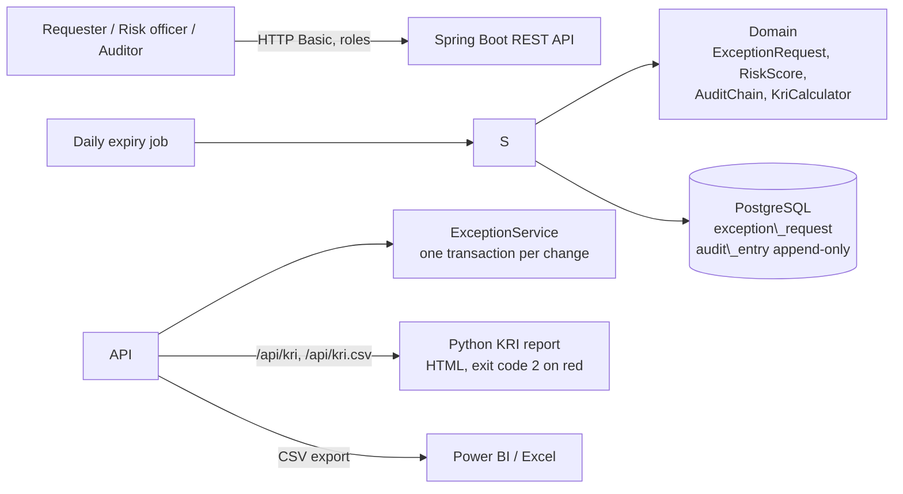

# Security Exception Register

Sometimes a system cannot meet a security policy yet: a legacy server cannot take an OS patch until a vendor upgrade, or an admin console waits for SSO before it gets MFA. Security teams then grant a **time-limited exception** and record the risk. In many companies this lives in a spreadsheet, where nobody notices expired approvals, people approve their own requests, and history can be edited quietly.

This service keeps that register, with the rules built in:

* **Risk scoring.** Likelihood × impact on a 5×5 matrix gives the inherent risk. Compensating controls lower the likelihood to give the residual risk, but only if they have been tested.
* **Four-eyes approval.** A risk officer approves, and that officer can't be the requester or the system owner. A CRITICAL residual risk needs two different officers.
* **Expiry built in.** The residual rating caps how long an exception may run: 30 days for CRITICAL, 90 for HIGH, 180 for MEDIUM, 365 for LOW. A daily job marks approved exceptions as expired once their date passes, and renewing means getting approved again.
* **Tamper-evident audit trail.** Every change writes an audit entry that is hash-chained to the one before it. The database refuses `UPDATE` and `DELETE` on the trail, and `/api/audit/verify` recomputes the whole chain.
* **Key risk indicators (KRIs).** The service exposes five indicators with green/amber/red thresholds, as JSON and as CSV for Power BI or Excel. A small Python job turns them into the weekly report below and exits with code 2 when an indicator is red.

!\[KRI report generated from sample data](docs/img/kri-report.png)

> Portfolio project, built to learn how IT risk teams work. The data is made up and the thresholds are examples. It is not affiliated with any company.

## Architecture



All business rules sit in `domain/`, which is plain Java with no Spring or JPA annotations. The web layer checks roles, and the domain checks everything that depends on the data: four-eyes, status transitions and expiry limits. So even a bug in the controller cannot approve your own request.

## Run it

```bash
docker compose up -d --build --wait          # app on :8080, PostgreSQL 17
cd tools/kri\_report
python seed\_demo.py --url http://localhost:8080
python kri\_report.py --url http://localhost:8080 --out report.html
```

Demo users (password `demo`): `alice` and `olivia` file requests (olivia owns the systems), `bob` and `carol` are risk officers, and `dave` is an auditor.

```bash
# file a request as alice
curl -u alice:demo -H 'Content-Type: application/json' localhost:8080/api/exceptions -d '{
  "title": "Admin console still without MFA", "assetId": "APP-ADM-007",
  "policyReference": "POL-IAM-04 2.1", "justification": "SSO integration planned for Q1",
  "owner": "olivia", "likelihood": 4, "impact": 5,
  "controls": \[{"description": "IP allow-list on the load balancer", "effectiveness": "PARTIAL"}],
  "requestedExpiry": "2027-02-15"}'

curl -u alice:demo -X POST localhost:8080/api/exceptions/{id}/submit
curl -u bob:demo -H 'Content-Type: application/json' localhost:8080/api/exceptions/{id}/approve -d '{"comment":"ok"}'
curl -u dave:demo localhost:8080/api/exceptions/{id}/audit
curl -u dave:demo localhost:8080/api/audit/verify          # {"intact":true,...}
curl -u dave:demo localhost:8080/api/kri.csv
```

|Endpoint|Who|
|-|-|
|`POST /api/exceptions`, `/{id}/submit`, `/{id}/renew`|requester|
|`POST /{id}/approve`, `/{id}/reject`|risk officer (not requester or owner)|
|`POST /{id}/close`|requester, owner or risk officer|
|`GET /api/exceptions\[?status=]`, `/{id}`, `/api/kri`, `/api/kri.csv`, `/api/export/exceptions.csv`|any signed-in user|
|`GET /{id}/audit`, `/api/audit/verify`|auditor, risk officer|

Errors come back as RFC 9457 problem details. A broken rule returns `422` with the rule's own message, for example *"A HIGH exception may run at most 90 days"*, and a concurrent change returns `409`.

## Key risk indicators

|KRI|Why a risk team watches it|Amber / red (demo)|
|-|-|-|
|Expired exceptions not closed or renewed|The gap is still open, but nobody has accepted it any more|1 / 3|
|Approved exceptions with CRITICAL residual risk|Should be rare and short-lived|1 / 3|
|% approved without an effective (tested) control|Untested controls are only promises|25 % / 50 %|
|Requests waiting > 10 days for a decision|A slow process pushes people to work around it|2 / 5|
|Exceptions renewed two or more times|A "temporary" exception that has become permanent|1 / 3|

The thresholds live in one record, `KriCalculator.Thresholds`, because in a real team they come from the risk appetite statement, not from code.

## Design decisions

* **Only the best control counts** ([ADR 1](docs/adr/0001-residual-risk.md)). Three "partial" controls don't add up to one effective control, and summing them would let a pile of weak measures hide a critical gap.
* **JSON columns for controls and approvals** ([ADR 2](docs/adr/0002-json-columns.md)). They are always read and written together with their request, so separate tables would add joins without adding any value here.
* **Hash chain plus an append-only trigger** ([ADR 3](docs/adr/0003-hash-chained-audit-log.md)). Tampering becomes visible, but it is not impossible: someone with full database rights could rebuild the whole chain. A production setup would also publish the latest hash somewhere else.
* **Optimistic locking.** Two officers approving the same request at the same moment cannot overwrite each other; the second one gets `409`.
* **CSV export defuses formulas.** Values starting with `=`, `+`, `-` or `@` get a leading apostrophe, so a title typed by a user cannot run as a formula in Excel.

## Tests

* `domain/`: 30 unit tests for scoring bands, residual risk, four-eyes, expiry limits, renewals, KRI counts and audit chain tampering (edited, deleted and re-hashed entries).
* `web/ExceptionApiIntegrationTest`: the full stack against PostgreSQL in Testcontainers, covering the lifecycle, roles, the 422 messages, and the database refusing to edit the audit trail.
* `tools/kri\_report/tests`: 7 pytest tests for report lists, exit codes and HTML escaping.

```bash
mvn verify                          # needs Docker for Testcontainers
cd tools/kri\_report \&\& pip install -r requirements-dev.txt \&\& pytest
```

CI runs all three, then starts the app with Docker Compose, seeds it and uploads the generated report as a build artifact.

## Tech

Java 24, Spring Boot 3.5 (Web, Security, JDBC, Validation, Actuator), PostgreSQL 17, Flyway, JUnit 5, Testcontainers, JaCoCo, Docker, GitHub Actions, Python 3 (standard library only).

MIT licence.

